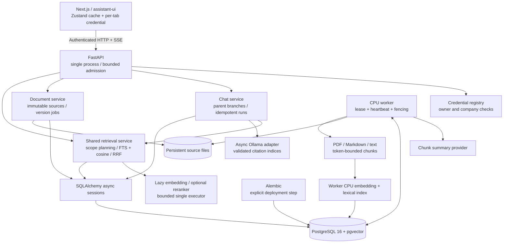

# Architecture and API contracts

## Architecture

## API and stream contract

Interactive OpenAPI: `/docs`; machine schema: `/openapi.json`. Protected endpoints require `Authorization: Bearer <assigned token>`. Errors use `detail`, and responses include `X-Request-ID`. Logs contain request identifiers, paths and statuses; failures are redacted for the client. Do not log request text, uploaded content or tokens at the proxy.

- `POST/GET /v1/threads`: create and list owned threads. Listing has `offset`, bounded `limit` and `next_offset`; order is creation time then ID. Offset pagination is intended for this initial single-user session UI, not a consistent snapshot during concurrent mutations.
- `PATCH /v1/threads/{id}`: title, regular/archived status, or active branch head. `DELETE` cascades owned messages, runs and source references. Active generation must be cancelled first.
- `GET /v1/threads/{id}/messages`: current path or `head_id`; results are chronological. `older_head_id` is the cursor for older ancestors. `GET .../branches` lists saved assistant heads.
- `POST /v1/threads/{id}/messages`: `{text, model_id, idempotency_key, parent_id?}`. Omitted parent appends; explicit `null` makes a new root. A parent must be an assistant in this thread. The transaction creates both messages and the run before returning 202. Repeating the same key/payload returns the same run; changed payload returns 409. Only one active run is allowed per thread.
- `GET /v1/runs/{id}` returns durable state, partial/final message and citations. `POST .../cancel` persists cancellation and available partial text. A disconnect alone does not cancel generation.
- `GET /v1/runs/{id}/events` is authenticated SSE. `snapshot` events carry the entire persisted message and run status. Replace the cached answer; do not append snapshots as tokens. `terminal` carries completed/failed/cancelled/interrupted state. Completion is emitted only after committing the final answer and source references. Comment heartbeats keep idle streams alive. No exact token replay or Last-Event-ID protocol is claimed.
- Unexpected EOF is a connection failure; fetch durable run state and reconnect. Completed is the only success status. Restart marks orphaned queued/running runs interrupted. In a DB outage, the last successful partial save is the recovery point. Restart the failed-closed API after database recovery; startup marks orphaned runs interrupted. Reconnect reloads durable message/run state and clears a stale UI running flag without overwriting a newer submission or stream snapshot.
- `GET /v1/models` supplies actual model IDs/labels. `POST /v1/models/warmup` is administrator-only. Internal Ollama `thinking` fields never enter the answer stream. Numeric citation references outside supplied evidence or absent on an evidence-based answer cause a failed run; this validates references, not factual correctness.
- `POST /v1/tool/retrieval` preserves the previous request/response fields and adds version references, effective scopes and per-scope coverage. The old `/app/v1/chat/stream` interface is not used by the integrated frontend. Retired Next.js `/api/*` endpoints have been removed; the frontend calls FastAPI directly.
- Document upload/reindex/job/source APIs are described in HANDOFF.md. Explicit retry is permitted only for failed jobs below the configured attempt limit. Expired running leases are automatically reclaimed. Old workers cannot publish after losing their lease token. Claim/heartbeat/database failures no longer terminate the worker loop: retries back off up to `RAG_WORKER_RETRY_MAX_SECONDS` (default 30). Heartbeat failure cancels the current work. Parsers run in a separate process group, killed and reaped on cancellation or `RAG_PARSER_TIMEOUT` (default 300 seconds); timed-out jobs fail and subsequent jobs continue. The worker Compose service also restarts unless explicitly stopped.

## Retrieval behavior

Retains ruri document/query prefixes (`検索文書: ` / `検索クエリ: `), attention-mask mean pooling, normalized 768-dimensional embeddings, Sudachi B lexical tokens, PostgreSQL full-text ranking, cosine retrieval and reciprocal-rank fusion with stable ID tie-breaking. This is PostgreSQL FTS, not BM25. Optional BGE reranking runs after fusion.

Years are no longer hardcoded to 2023–2026. Multiple requested periods remain distinct, including the same month in different years. Missing company means the principal's allowed companies. Explicit fields override inferred values; reporting periods and ISO meeting dates are separate. Scope expansion is capped at 24 and excessive combinations return 422. Candidate pools cover `top_k` up to 50. Round-robin allocation reports coverage when the requested result count cannot cover every scope.

Follow-up resolution conservatively inherits unambiguous company/department/period information only when the latest query contains supported follow-up language. Explicit new periods/entities win. It is deterministic, not an unrestricted LLM query rewriter. Ambiguous follow-ups may require users to restate the company/period.

Only ready, active document versions with matching embedding model/revision/backend are searched. Changing a revision therefore requires reindexing; retained sources support that operation. Defaults/examples pin immutable embedding and reranker commits. Real indexing/inference rejects floating revisions. Submitted jobs snapshot their indexing contract; a mismatched worker fails the job before publishing. Chunk summaries are generated by the retained Qwen summary model and persisted in `document_chunks.summary`; failures preserve the previously active version. Original chunk text remains the retrieval/answer evidence.

### Retrieval context and canonical metadata

Each run stores its resolved retrieval request in `configuration.retrieval_request`. Follow-ups inherit from the selected parent branch, including after restart and beyond the answer-history window. Explicit company/period changes take precedence; independent questions and explicit topic resets clear inherited scope. Older branches without stored context are replayed from their saved ancestry.

Document upload and explicit retrieval fields use the same NFKC/alias normalization before authorization and persistence. Known company/dept/section relationships are validated; custom configured tenants keep their own taxonomy. For example, `denki` / `本社営業` are stored and queried as `共立電機製作所` / `営業部`. Previously stored noncanonical metadata is not silently rewritten; inventory it before importing existing data.

New imports/reindexes record chunker `heading-table-token-v2`. Every table continuation repeats its heading and column header, within the token budget. A heading/header that alone exhausts the budget causes an explicit processing failure instead of silently discarding labels. Previously indexed versions retain their original chunks and citations; use a new reindex import key to create a replacement version.

## Code boundaries

FastAPI routes in `backend/src/kyoritsu_backend/api/routes/` validate HTTP input and call services. Services own workflows; repositories own shared queries; schemas define wire responses. Application errors are translated at `api/exceptions.py`. `main.py` assembles these pieces and retains health/lifespan handling. Startup recovery is a service.

The frontend keeps route composition in `src/app/`, authentication and chat behavior in `src/features/`, shared primitives in `src/components/ui/`, and transport helpers in `src/lib/`. The chat feature owns its state and Date-based view models.

Backend request/response schemas are the contract source. Run `.venv/bin/python backend/scripts/export_contracts.py` from the repository root to regenerate `frontend/src/lib/contracts/api.ts`; CI uses `--check` to detect drift. Generated types describe the wire format (ISO date strings); they are compile-time contracts, not runtime payload validators. SSE framing remains in the transport adapter.
