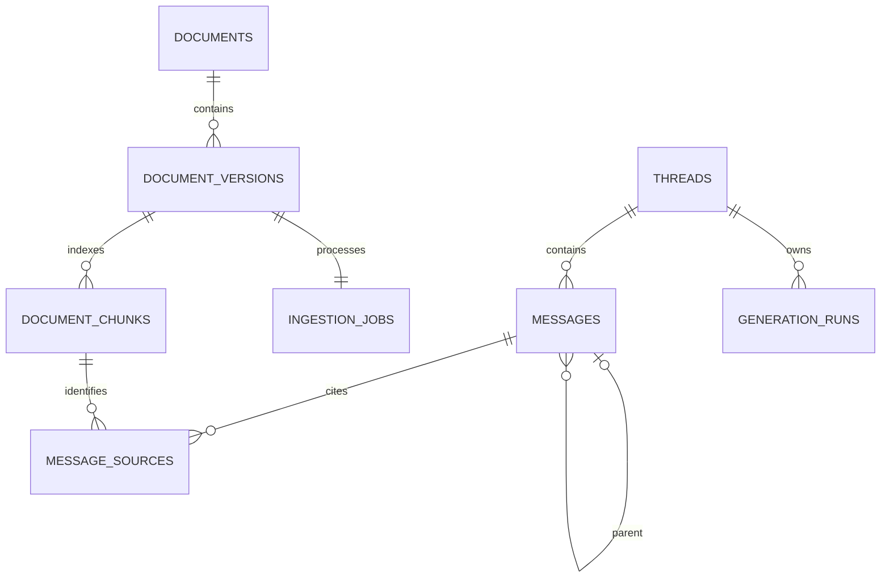

# Database and recovery

`documents.active_version_id` changes atomically after successful indexing. Source versions and chunks are retained. A thread's `head_id` selects a parent chain; edit/regenerate creates a new user/assistant pair on an earlier parent, leaving old paths intact. Message sources identify immutable chunks/versions, rather than just filenames.

## Model ownership

`db/base.py` defines the shared declarative base and timestamp/ID helpers. `db/models/chat.py`, `documents.py`, and `ingestion.py` own mapped domains. `db/models/__init__.py` registers all models for Alembic and consumers. The structural refactor does not rename tables or change migration revisions.

## Existing data and recovery

Read-only inspection on 2026-10-13 found **no public application tables** in the existing `rag_postgres/rag_database`. PostgreSQL 16.13 was running and vector 0.8.2 was available but not enabled. That database was not migrated or modified. Local datasets/SQL drafts and the separate K-RAG chat store are not proven copies of that live state.

Do not run the fresh baseline over a populated legacy database or blindly stamp it. First use `rag-admin inspect-db`, inventory source files and take backups. Restore into a separate database. Map legacy document IDs, metadata, vectors and retained files explicitly; map `global-user` chat ownership to approved identities, and preserve original text/timestamps/citations. A production legacy importer is intentionally not guessed from the stale SQL draft. It remains an acceptance dependency if retained legacy records are located.

For an integrated database, stop API/worker writes and back up the complete DB (`pg_dump -Fc`) plus the configured source directory at the same recovery point. Record the application commit, Alembic revision, model revisions and source checksums. Test `pg_restore` into a new database before changing connection configuration. Run `alembic upgrade head` on that restored copy and verify counts, identifiers, embedding dimensions, orphan checks and citation downloads. Keep the original database and volumes until acceptance. A destructive Alembic downgrade is not a backup strategy; the reindex migration's downgrade may reject duplicate content versions by design.

The original Compose bind mount `/mnt/llm/docker/data/rag_postgres/data`, user modifications and sibling `../K-RAG` were preserved. Private datasets, evaluation artifacts and old source files were archived and checksum-verified before removal from the active layout; see CLEANUP_MANIFEST.md.
